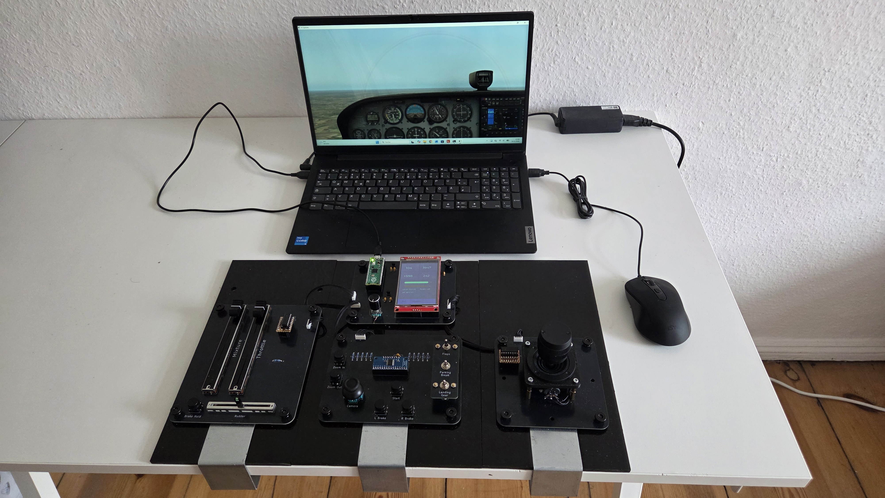

# Modular Embedded Flight Deck (X-Plane 11)

<p align="center">
  
</p>

A modular desktop flight simulator cockpit for X-Plane 11, built around a Raspberry Pi Pico (RP2040), LVGL, and 4 custom KiCad PCBs, with an experimental v2.0-beta architecture upgrading the display to a capacitive ESP32-S3 IPS touch module and splitting Wi-Fi telemetry from real-time USB HID controls.

Flight Demo (Takeoff & Climb): [Watch on YouTube](https://youtu.be/x1ZjBMRiYiw?si=wxdTexv7rL8de2k_)

---

## System Overview

In v1.0, the system consists of a central controller board and three modular satellite boards connected via cables:

- Central Board: Raspberry Pi Pico (RP2040) running firmware written in C (Pico SDK), driving a resistive TFT touch display with LVGL for live telemetry and autopilot state/target display, paired with a rotary encoder for adjusting autopilot target values.
- Left Satellite Board: Dual sliders for Throttle and Mixture, a horizontal slider for Rudder, and an ergonomically placed brake toggle pushbutton right next to the rudder slider for simultaneous braking and steering during taxi/landing.
- Right Satellite Board: Compact 2-axis industrial joystick adapted as the primary pitch/roll flight input.
- Center Satellite Board: Mini-joystick for camera control, 2 buttons for camera zoom in/out, 2 assignable buttons (intended for left/right toe brakes; mapped to Battery & Avionics in the demo video), 2 toggle switches for Landing Gear and Parking Brake, and a 2-way (MOM)-OFF-(MOM) toggle switch for Flaps Up/Down.

### Communication & Simulator Bridge (v1.0)

- Flight Controls: Transmitted from the RP2040 via native USB HID.
- Telemetry & Autopilot Sync: Bidirectional exchange over USB CDC and a custom Python UDP bridge communicating with X-Plane 11.

Detailed Documentation:
- [System Architecture v1.0](docs/architecture-v1.md)
- [Hardware Bring-Up & Rework Notes (v0.9)](docs/hardware-rework-v0.9.md)
- [v2.0-beta Architecture, Wired Prototype Plan & Testing](docs/architecture-v2-outlook.md)

---

## Versions & Status

- v1.0 (Active) — Hardware: `pcb-v0.9` (with rework) + satellite PCBs | Software: `rp2040-v1` (HID + CDC) & Python UDP bridge | Status: Working & in use.
- PCB Rev 1.0 — Hardware: `pcb-v1.0-revised` (mainboard + 2 revised satellites) | Software: Compatible with `rp2040-v1` | Status: KiCad layout updated (not ordered).
- v2.0-beta (Outlook) — Hardware: `pcb-v0.9` wired to ESP32-S3 IPS display | Software: `rp2040-v2-hid-only` + `esp32-s3-v2-display` | Status: Experimental / wired test planned (no new PCB spin).

### Motivation for v2.0-beta

The primary driver for v2.0-beta is display ergonomics and usability: the current TFT display suffers from strong color inversion/distortion when viewed at an angle from a seated desk position, and its resistive touch layer requires firm pressure. Upgrading to an ESP32-S3 integrated capacitive IPS LCD solves both issues while naturally offloading Wi-Fi UDP telemetry and LVGL UI rendering from the RP2040—leaving the RP2040 dedicated solely to deterministic real-time I/O and native USB HID (creating headroom for future input filtering and features). For initial testing, the ESP32-S3 module will be wired directly to the existing `pcb-v0.9` mainboard.

---

## Hardware Bring-Up & Lessons Learned (v0.9 -> v1.0)

Bringing up the manufactured `pcb-v0.9` boards (KiCad, fabricated via JLCPCB) revealed two layout mistakes that were reworked directly on the hardware and fixed in `pcb-v1.0-revised` (see [docs/hardware-rework-v0.9.md](docs/hardware-rework-v0.9.md)):

- DIP-16 footprint too wide (2 satellite PCBs): Mounted DIP-16 sockets onto the PCBs via small perfboard adapters during bring-up; corrected the DIP-16 footprint in `pcb-v1.0-revised`.
- Swapped rotary encoder pinout (Central board): Cut traces and rerouted two pins using magnet/coil wire (`bodge wires`) during bring-up; fixed schematic pinout and PCB routing in `pcb-v1.0-revised`.
- Incorrect mounting geometry on `Flightstick_Top` PCB: Used a 3D-printed mounting plate as a workaround to mount the flight stick in `v0.9`; fixed the board geometry in `pcb-v1.0-revised`.

---

## Possible Future Extensions

- HUD-Style Display Layout: Replacing boxed numeric telemetry readouts with an aviation-style artificial horizon / HUD layout in LVGL.
- Camera Joystick Smoothing Filter: Adding a digital low-pass / exponential moving average filter on the RP2040 to eliminate jitter when deflecting the mini-joystick from its center deadzone.
- Angled Display Mount via Minimal Wiring: On a dedicated `v2.0` central PCB, the ESP32-S3 display only requires two 4-pin connectors (1x UART + 1x Rotary Encoder), making it easy to mount the display at an ergonomic viewing angle using a simple mechanical spacer/bracket.

---

## Repository Structure

```text
.
├── README.md
├── docs/
│   ├── hardware-rework-v0.9.md      # Bring-up issues, rework notes & photos
│   ├── architecture-v1.md           # Current v1.0 hardware & software architecture
│   └── architecture-v2-outlook.md   # v2.0-beta split architecture & wired v0.9 test notes
├── hardware/
│   ├── pcb-v0.9-manufactured/       # KiCad files for manufactured v0.9 boards
│   └── pcb-v1.0-revised/            # Revised KiCad files (unmanufactured bugfix revision)
├── firmware/
│   ├── rp2040-v1/                   # C / Pico SDK firmware (I/O, LVGL, USB HID + CDC)
│   ├── rp2040-v2-hid-only/          # Planned lean RP2040 firmware (HID & controls only)
│   └── esp32-s3-v2-display/         # Planned ESP32-S3 firmware (Wi-Fi UDP & LVGL UI)
├── bridge/
│   ├── xplane_bridge.py             # Python UDP bridge for X-Plane 11
│   └── XPlane_Setup.md              # Setup for X-Plane 11
└── media/                           # Photos, diagrams & hardware rework documentation
