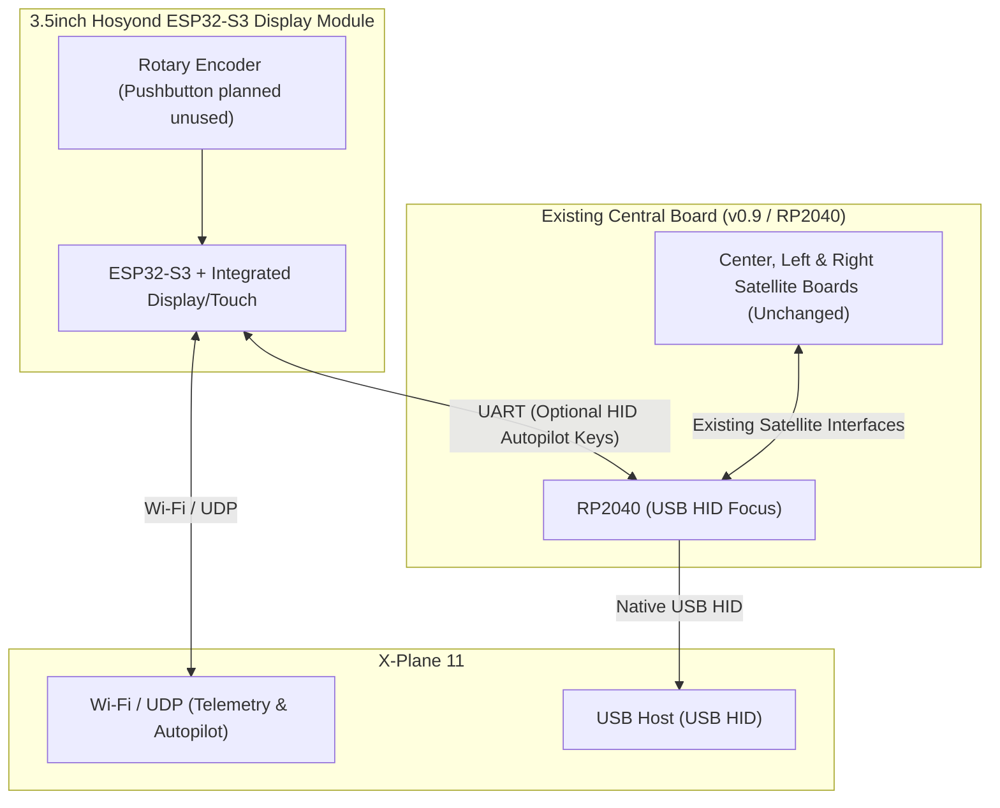

# v2.0-beta Architecture, Wired Prototype Plan & Testing

This document outlines the planned **v2.0-beta** architecture, the wired prototype setup using the existing `v0.9` hardware, and upcoming test notes.

---

## Architecture Overview & Key Differences from v1.0

The underlying hardware topology of the satellite boards (Center, Left, and Right) remains the same as in **v1.0**, while display, UI/encoder handling, and simulator network communication move to an integrated display controller:

- Integrated Display Module: A 3.5-inch Hosyond display module with an integrated ESP32-S3 replaces the standalone resistive TFT + HR2046 touch setup driven directly by the RP2040.
- Rotary Encoder on ESP32-S3: The rotary encoder is connected directly to the ESP32-S3 rather than the RP2040; the encoder pushbutton is planned to remain unconnected.
- RP2040 Role Reduction (HID-Only): Because telemetry and autopilot data no longer flow over USB CDC from the RP2040, the RP2040 only needs USB HID communication for flight controls.
- Wi-Fi Telemetry & Autopilot Sync on ESP32-S3: The ESP32-S3 receives telemetry directly over Wi-Fi and sends autopilot values/updates over Wi-Fi to X-Plane 11 (replacing the v1.0 USB CDC path for autopilot values).
- UART Link (ESP32-S3 <-> RP2040): A UART connection links the ESP32-S3 and RP2040 to keep the option open to send autopilot button/key actions via USB HID through the RP2040 to X-Plane 11.

### Planned v2.0-beta Block Diagram

## Wired Prototype Plan (Using Existing `v0.9` Hardware)

For initial prototyping, the Hosyond ESP32-S3 module will be wired directly to the existing `pcb-v0.9` setup without ordering a new PCB revision first.

- Power & Ground: Verify shared ground reference between the ESP32-S3 module and the `v0.9` central board and check power rail limits/level compatibility before connecting UART.
- UART Wiring: Connect TX/RX (with proper logic-level check) between the ESP32-S3 and RP2040 for optional autopilot-key-to-HID forwarding.
- Encoder Wiring: Wire the rotary encoder channels to the ESP32-S3 (pushbutton omitted).

## Testing & Bring-Up Notes (To Be Expanded)

This section will be updated once the wired prototype is assembled and firmware (`rp2040-v2-hid-only` and `esp32-s3-v2-display`) is tested:

- Wi-Fi UDP telemetry latency and stability with X-Plane 11.
- Autopilot value updates over Wi-Fi and optional HID autopilot key forwarding over UART.
- Side-by-side comparison of display readability, touch responsiveness, and overall cockpit ergonomics against v1.0.
