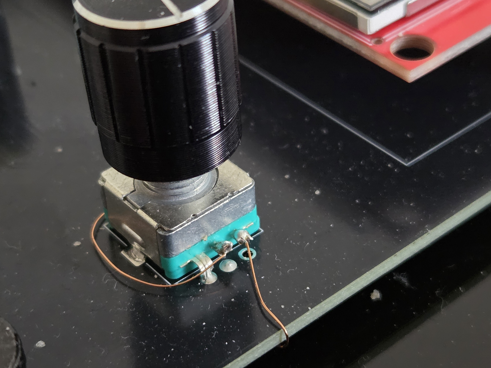
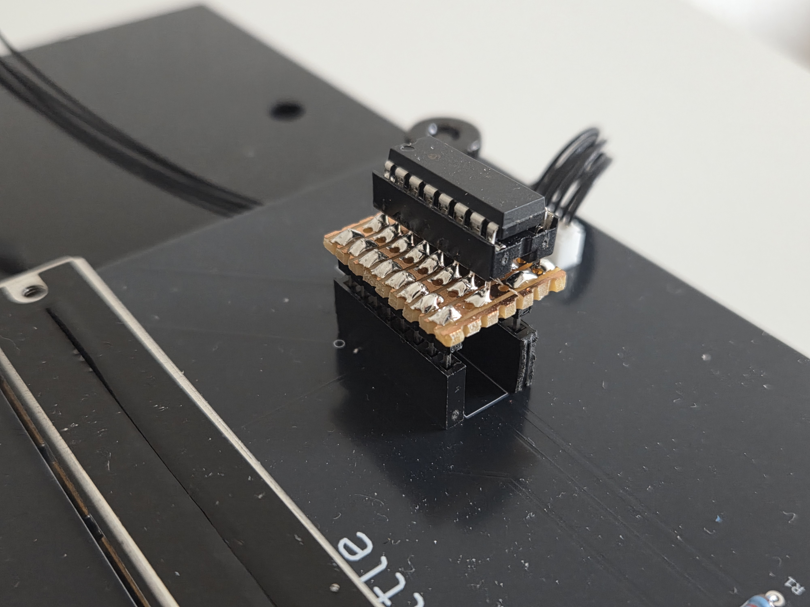
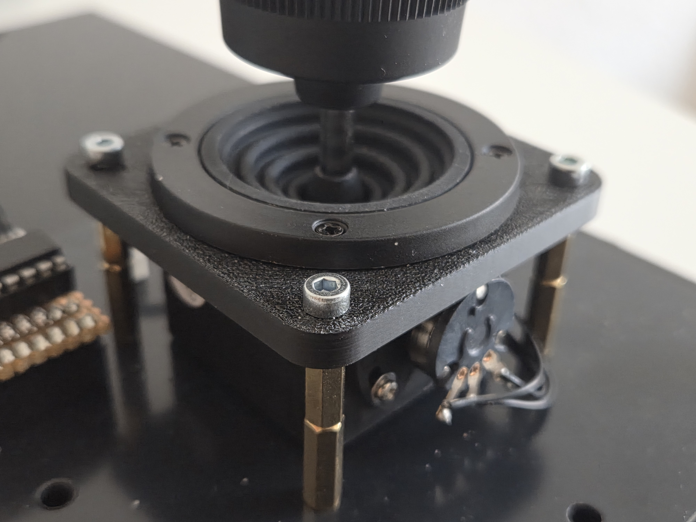
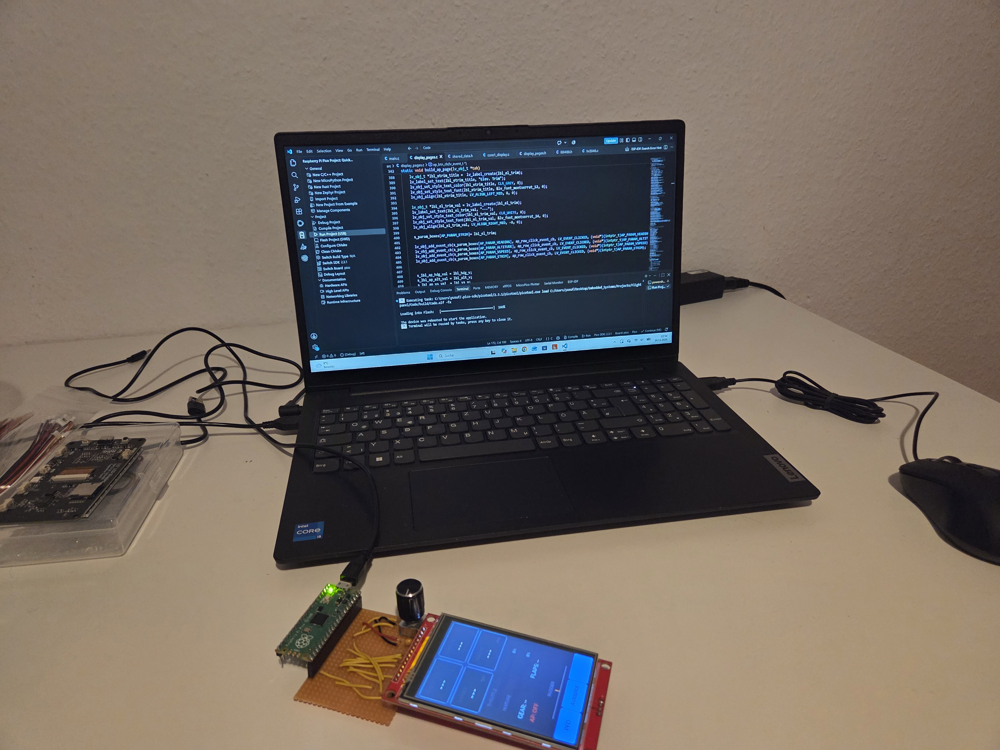
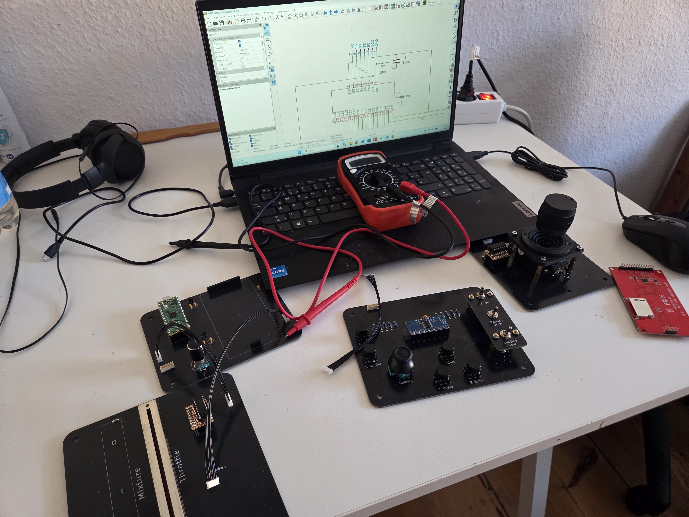

# Hardware Bring-Up & Rework Notes (v0.9 -> v1.0)

This document records the hardware bring-up issues encountered on the manufactured `pcb-v0.9` boards (designed in KiCad and fabricated via JLCPCB), the pragmatic workarounds and debugging steps used to bring the v1.0 system into operation without waiting for a new PCB order, and the corresponding fixes in `pcb-v1.0-revised`.

---

## PCB & Mechanical Rework (v0.9 -> v1.0)

### 1. Rotary Encoder Pinout Mismatch (Central Board)

- Root Cause: In the KiCad footprint for the rotary encoder, pin B was assigned as GND and pin C as step/CCW, whereas the KiCad symbol defined pin B as CCW and pin C as GND.
- Hardware Workaround: Trimmed/cut the two affected solder pins on the encoder, routed the pin mistakenly tied to GND around the board edge from underneath to the proper signal connection using enameled magnet/coil wire, and routed the pin mistakenly tied to CCW around the encoder to the GND pin of the encoder pushbutton.
- Fix in `pcb-v1.0-revised`: Corrected the symbol-to-footprint pin mapping and PCB routing.

### 2. MCP3208 DIP-16 Footprint Width Mismatch (Satellite Boards)

- Root Cause: Selected a 10.16 mm wide DIP-16 socket footprint instead of the required 7.62 mm width for the MCP3208 ADCs.
- Hardware Workaround: Used small stripboard (veroboard) pieces, scored/cut the copper traces down the middle with a hobby/utility knife so opposite sides had no electrical connection, and bridged them to the board using pin headers/sockets.
- Fix in `pcb-v1.0-revised`: Updated the DIP-16 footprint to the 7.62 mm width.

### 3. `flightstick_top` PCB Geometry & Mounting Hole Mismatch

- Root Cause: Designed the `flightstick_top` board with incorrect mounting hole positions for the joystick housing and a circular cutout that was too small for the joystick grip/shaft to pass through.
- Hardware Workaround: Instead of ordering revised PCBs right away, 3D-printed a custom mounting plate to mount the joystick cleanly for v1.0 operation.
- Fix in `pcb-v1.0-revised`: Fixed the circular cutout diameter and mounting hole positions in the `flightstick_top` layout.

---

## Firmware & Bring-Up Debugging Notes

Alongside physical PCB/mechanical rework, bringing up the firmware and wiring harnesses involved several tricky debugging sessions:

### 1. Touch Screen Ghost Coordinates in LVGL (Bottom-Right Corner)

- Issue: With LVGL, the touch input occasionally reported the maximum touch coordinates (bottom-right corner) right after a touch release, likely due to a touch/SPI timing quirk.
- Solution: Filtered out touch readings hitting the extreme min/max boundary coordinates so phantom corner releases do not trigger unwanted UI actions.

### 2. Rotary Encoder Debouncing, Polling & Acceleration

- Issue: The initial interrupt-driven encoder implementation suffered from false triggers where CW and CCW steps triggered each other.
- Solution: Switched to polling for more reliable state handling and added rotation acceleration—especially helpful when dialing in large heading changes quickly.

### 3. Satellite Boards Not Responding (Reversed JST Connector Wiring)

- Issue: None of the satellite boards worked initially during bring-up, prompting an extra trip to a hardware store for a multimeter (expensive for the quality, in hindsight).
- Root Cause: The cables were simply inserted backwards into the JST housings.
- Lab / Bring-Up Photo: ``

